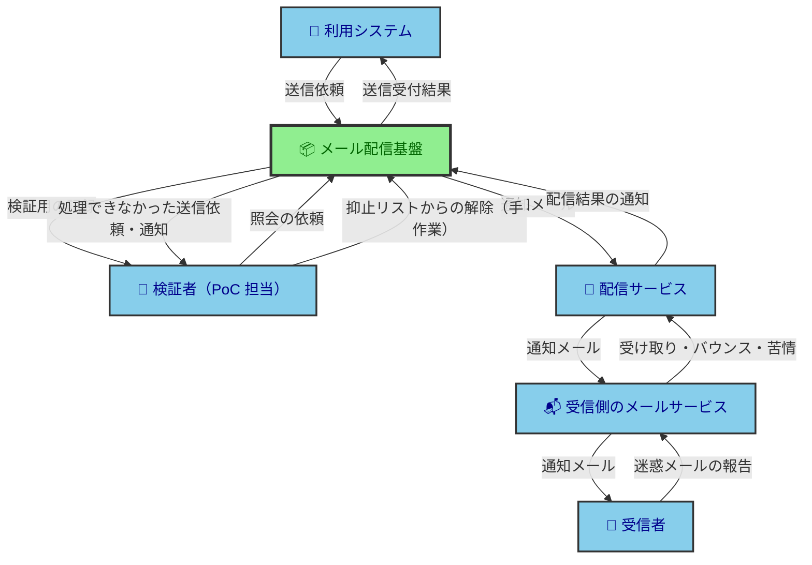
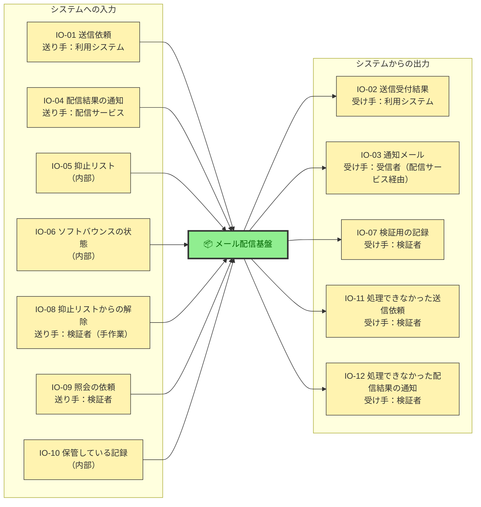
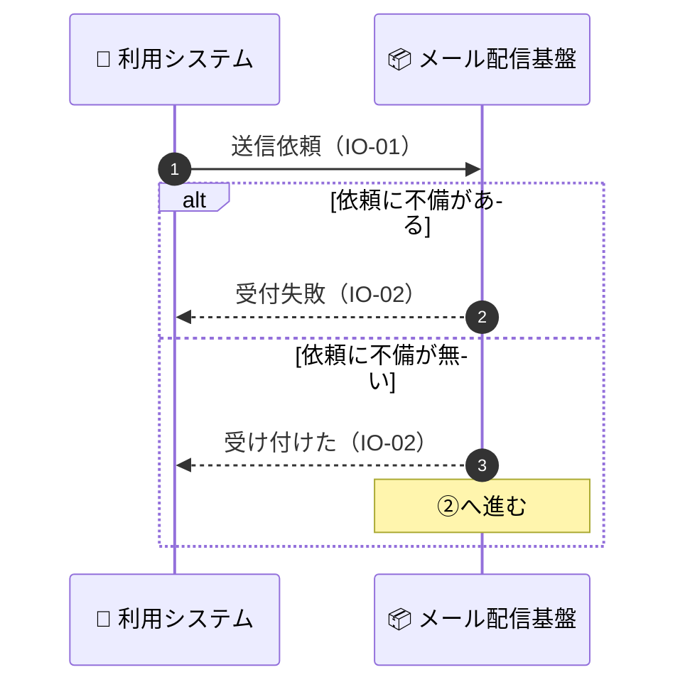
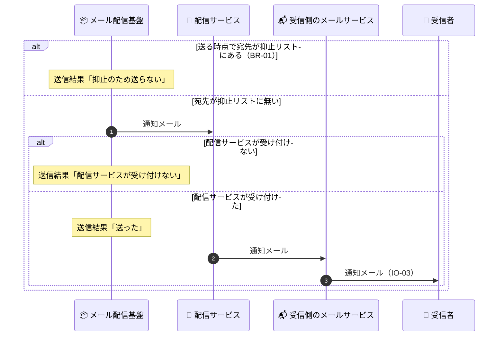
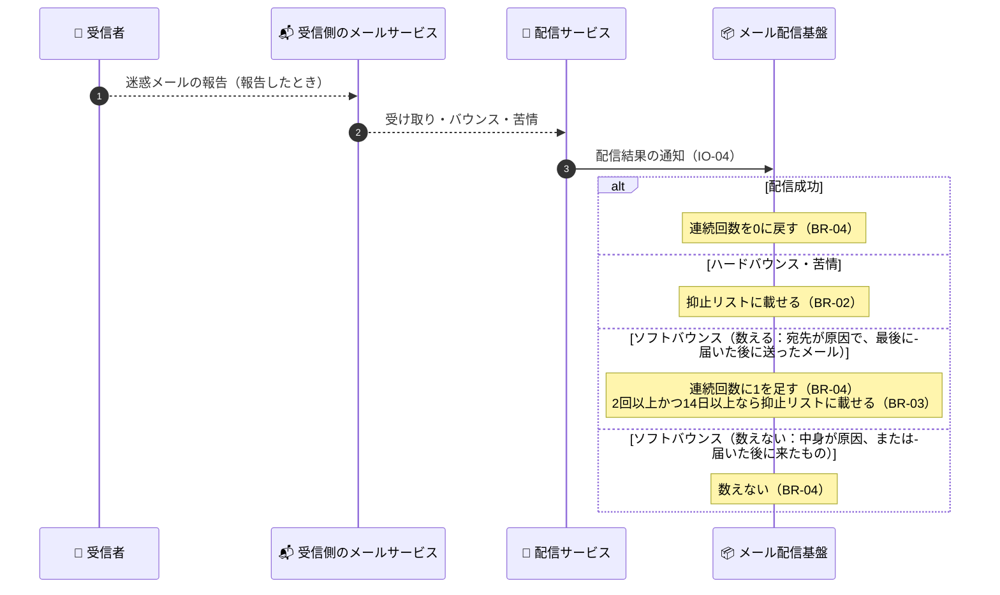
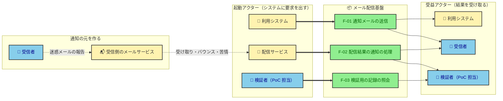

# 要件定義書：メール配信基盤 PoC

このシステムに何が求められているかを知りたい開発者／AI・関係者が参照する。
書くのは**ビジネスの基準（What）**であり、実装の手段（How）は設計書とコードの領分。

## 概要

社内のシステムからメールの送信依頼を受け付け、通知メールを届けるメール配信基盤の PoC である。

配信サービスには Amazon SES を使い、利用システムは配信サービスを意識せずに送信を依頼できる。

送ってはいけない宛先は自前の抑止リストで管理し、その宛先への送信を止める。

## 目的

本番のメール配信基盤プロジェクトを始める前に、メール配信と Amazon SES の仕様・機能を理解し、落とし穴と重要な論点をつかむ。

## 背景・入力元

| 入力元                                   | 内容                                                              |
| ---------------------------------------- | ----------------------------------------------------------------- |
| [PoC の元メモ](project-context/input.md) | 人間が決めた PoC の概要・目的・要件・前提・検証項目・やらないこと |

## 用語定義

全社共通語は用語集（[glossary.md](project-context/glossary.md)）を参照。

| 用語             | 定義                                                                                                                                                                                                             |
| ---------------- | ---------------------------------------------------------------------------------------------------------------------------------------------------------------------------------------------------------------- |
| 利用システム     | メール配信基盤に送信を依頼する社内のシステム                                                                                                                                                                     |
| 配信サービス     | メールを実際に送り出す外部のサービス。Amazon SES・SendGrid など                                                                                                                                                  |
| 自前の抑止リスト | メール配信基盤が持つ、以後メールを送らない宛先の一覧。配信サービスが持つ抑止リスト（SES のアカウント単位の抑止リストなど）とは別に持つ                                                                           |
| 検証項目         | PoC で確かめる事項。それぞれが「何が分かれば完了か」を持つ                                                                                                                                                       |
| 抑止リスト       | 自前の抑止リストの略。配信サービスが持つ抑止リストは「配信サービスの抑止リスト」と書いて区別する                                                                                                                 |
| ハードバウンス   | 宛先が存在しないなど、永続的な理由でメールが届かなかったこと                                                                                                                                                     |
| ソフトバウンス   | 配信サービスが、一時的な失敗（受信箱がいっぱいなど）か、理由を判定できない失敗として通知したもの。配信サービスが再送しても届かなかったときに通知が来る。届いた後に来る不在の自動応答が、この通知になることもある |
| 苦情             | 受信者がメールを迷惑メールとして報告したこと。受信側のメールサービスから、配信サービスを通じて通知が来る                                                                                                         |

## ターゲットユーザー

| ユーザー           | 何のために使うか                                                         |
| ------------------ | ------------------------------------------------------------------------ |
| 利用システム       | 配信サービスを選ばずに、登録完了メールのような通知メールの送信を依頼する |
| 検証者（PoC 担当） | 送信・バウンス・苦情・抑止の結果を確かめ、落とし穴と論点を記録する       |

## ステークホルダー／関係者

| 役割     | 立場                                                                         |
| -------- | ---------------------------------------------------------------------------- |
| PoC 担当 | 意思決定者（PoC の範囲と完了を決める）であり、分かった落とし穴と論点を使う人 |

## エコシステムマップ

**凡例：** 🟩 緑＝開発範囲（内） ／ 🟦 青＝外部アクター・外部システム（外）。矢印は授受の向き（誰から誰へ渡るか）を表す。線種は1種類に統一（種別の区別はしない）。

## 解決する課題

| 誰の               | どんな困りごと                                                                                                   |
| ------------------ | ---------------------------------------------------------------------------------------------------------------- |
| 検証者（PoC 担当） | メール配信と Amazon SES の仕様・機能を理解しておらず、本番で踏みそうな落とし穴と、先に決めるべき論点が分からない |
| 利用システム       | メールを送るには、配信サービスを選び、そのサービスの仕様に合わせて作り込む必要がある                             |

## 業務要件

### 業務一覧

| 大分類           | 中分類           | 小分類                         | 概要                                                                                                                                                  | システム化区分 | 関連ルールID                                                                                                                                      |
| ---------------- | ---------------- | ------------------------------ | ----------------------------------------------------------------------------------------------------------------------------------------------------- | -------------- | ------------------------------------------------------------------------------------------------------------------------------------------------- |
| 通知メールの配信 | 送信             | 通知メールの送信               | 利用システムの送信依頼を受け、抑止リストに無い宛先へ通知メールを送る                                                                                  | システム化     | BR-01, BR-08, BR-09, BR-11, BR-12, BR-13, BR-14, BR-15, AC-01, AC-02, AC-03, AC-04, AC-05, AC-06, AC-14, AC-19                                    |
| 通知メールの配信 | 抑止             | 抑止リストへの登録             | 配信結果の通知を受け、以後送らない宛先を抑止リストに載せる                                                                                            | システム化     | BR-02, BR-03, BR-04, BR-05, BR-06, BR-08, BR-10, BR-13, BR-14, AC-01, AC-07, AC-08, AC-09, AC-10, AC-11, AC-12, AC-13, AC-15, AC-16, AC-17, AC-18 |
| 通知メールの配信 | 抑止             | 抑止リストからの解除           | 誤って載った宛先を、検証者（PoC 担当）が抑止リストから直接外す                                                                                        | 手動           | BR-07, BR-08, AC-01                                                                                                                               |
| 検証             | 送信ドメイン認証 | 認証結果の確認                 | 届いた通知メールで、SPF・DKIM・DMARC がすべて PASS かを確かめる                                                                                       | 手動           | BR-11                                                                                                                                             |
| 検証             | 到達             | 受信箱への到達の確認           | Gmail と Yahoo!メール（日本）で、受信箱・迷惑メール・届かないのどれになったかを記録する                                                               | 手動           | —                                                                                                                                                 |
| 検証             | 到達             | 大量送信者の要件の調査         | Gmail と Yahoo（米国）の大量送信者の要件を一覧にし、配信サービスの機能で満たせるものとそれ以外に分ける。日本の Yahoo!メールに同じ要件があるかも調べる | 手動           | —                                                                                                                                                 |
| 検証             | バウンス・苦情   | 通知の中身の確認               | バウンスと苦情を起こし、届いた通知の中身（ハードバウンスとソフトバウンスの見分け方など）を読み解く                                                    | 一部           | BR-05, BR-06, BR-10, BR-13, BR-15, BR-16, AC-07, AC-08, AC-09, AC-11, AC-14, AC-17                                                                |
| 検証             | 抑止             | 配信サービスの抑止リストの確認 | 配信サービスの抑止リストに、いつ・どの宛先が載り、どう外せるかを確かめる                                                                              | 手動           | BR-02, BR-03, BR-13, BR-16                                                                                                                        |
| 検証             | 送信停止         | 送信停止の条件の確認           | バウンス率・苦情率がどの値で何が起き、その率をどこで見られるかを確かめる                                                                              | 手動           | —                                                                                                                                                 |
| 検証             | サンドボックス   | サンドボックス解除の申請       | 解除しないと使えない機能を使いたくなったときだけ申請し、結果と審査で聞かれたことを記録する                                                            | 手動           | —                                                                                                                                                 |
| 検証             | 記録             | 落とし穴と論点の記録           | 検証で分かった落とし穴と、本番の前に決めるべき論点を書き残す                                                                                          | 手動           | BR-13, BR-16                                                                                                                                      |

通知メールの送信

**区分の理由**：利用システムの依頼を、人を介さずに送る必要がある。抑止リストとの突き合わせも、送るたびに漏れなく行う必要がある。

抑止リストへの登録

**区分の理由**：配信結果の通知は送ったメールの数だけ、いつ来るか分からないまま届く。漏れなく、次の送信より前に抑止リストへ載せる必要がある。

抑止リストからの解除

**区分の理由**：試験用の宛先（メールボックスシミュレーター）は、宛先にラベルを付けて変えれば同じ試験を繰り返せるので、解除の仕組みを作る価値が薄い。解除の機能は作らず、検証者が抑止リストを直接書き換える（IO-08）。

認証結果の確認

**区分の理由**：届いたメールのヘッダーを人が見て確かめる検証項目で、システムが代わりに判定するものではない。

受信箱への到達の確認

**区分の理由**：受信箱と迷惑メールのどちらに入れるかは受信側のメールサービスが決め、送る側からは見えない。人が受信箱を開いて確かめるしかない。

大量送信者の要件の調査

**区分の理由**：公開資料を読んで整理する調べ物で、システムが担う処理が無い。

通知の中身の確認

**区分の理由**：通知の受信と記録はシステムが行う（抑止リストへの登録に要るため）。中身を読み解くのは人が行う。

**補足**：試験用の宛先には、ソフトバウンスを起こす宛先が無い。ソフトバウンスは実際の受信箱で起こす必要がある（#43）。

配信サービスの抑止リストの確認

**区分の理由**：配信サービス側の振る舞いを人が観察して確かめる検証項目である。

送信停止の条件の確認

**区分の理由**：配信サービスの公開資料と管理画面を人が見て確かめる調べ物である。

サンドボックス解除の申請

**区分の理由**：申請は人が書き、審査は配信サービスの事業者が行う。

落とし穴と論点の記録

**区分の理由**：PoC の成果は、本番の判断に人が使う文章であり、システムが作るものではない。

### ビジネスルール一覧

| ID    | ルール名                                   | タイプ   | 関連ルール                                      |
| ----- | ------------------------------------------ | -------- | ----------------------------------------------- |
| BR-01 | 抑止リストにある宛先への送信の禁止         | 行動     | BR-08, BR-14, AC-06, AC-19                      |
| BR-02 | ハードバウンスと苦情による抑止             | 行動     | BR-05, BR-08                                    |
| BR-03 | ソフトバウンスの連続による抑止             | 行動     | BR-04, BR-08, AC-15, AC-17                      |
| BR-04 | ソフトバウンスの連続回数                   | 定義づけ | BR-03, BR-06, BR-14, AC-13, AC-15, AC-16, AC-17 |
| BR-05 | バウンスの種別                             | 定義づけ | BR-06                                           |
| BR-06 | ソフトバウンスの理由の区分                 | 定義づけ | BR-04, BR-05, AC-09                             |
| BR-07 | 抑止リストから外す主体                     | 行動     | BR-08                                           |
| BR-08 | 宛先ごとの登録の多重度                     | 定義づけ | BR-02, BR-03, BR-14, AC-01                      |
| BR-09 | 送信依頼と通知メールの関係                 | 定義づけ | BR-01, AC-06, AC-19                             |
| BR-10 | 通知メールと配信結果の通知の関係           | 定義づけ | BR-04                                           |
| BR-11 | 送信元の認証                               | 行動     | AC-02                                           |
| BR-12 | 本文の組み合わせ                           | 定義づけ | AC-04, AC-05                                    |
| BR-13 | 検証用の記録と元の情報の関係               | 定義づけ | BR-04, BR-08, BR-15, AC-19                      |
| BR-14 | 同じ宛先の判定                             | 定義づけ | BR-01, BR-04, BR-08, AC-01                      |
| BR-15 | 処理できなかった依頼・通知と元の情報の関係 | 定義づけ | BR-09, BR-13                                    |
| BR-16 | 照会の依頼と返す記録の関係                 | 定義づけ | BR-13                                           |

BR-01 抑止リストにある宛先への送信の禁止

本システムは、通知メールを送る時点で送信依頼の宛先が抑止リストに載っているとき（同じ宛先かどうかは BR-14）、その宛先へ通知メールを送ってはならない。

送信依頼を受け付けるかどうかは、抑止リストに左右されない。受付結果（AC-06）は抑止したかを含まず、送らなかったことは送信結果（AC-19）に残る。

BR-02 ハードバウンスと苦情による抑止

本システムは、ハードバウンス（BR-05）または苦情の配信結果の通知を受けたとき、その宛先を抑止リストに載せなければならない。抑止の理由は、ハードバウンスなら `ハードバウンス`、苦情なら `苦情` とする。

BR-03 ソフトバウンスの連続による抑止

本システムは、ソフトバウンスを数えた（BR-04）結果、その宛先の連続回数が2以上で、かつ続き始めた日時から14日以上たっているとき、その宛先を抑止リストに載せなければならない。抑止の理由は `ソフトバウンスの連続` とする。

この判定はソフトバウンスを数えるたびに行う。連続回数が2以上でも14日たっていなければ載せず、次に数えたときに改めて判定する。14日は、いま数えたソフトバウンスの通知の受信日時（AC-17）と、続き始めた日時（AC-15）の差で測る。境界値は、この差がちょうど14日（336時間）なら載せる点である。

**補足**：2回・14日は、メールの不正利用対策の業界団体 M3AAWG の送信者向けベストプラクティスが挙げる「2回以上続けて、2週間以上にわたって届かなかったら外す」に合わせた。

BR-04 ソフトバウンスの連続回数

連続回数（AC-13）は宛先（同じ宛先かどうかは BR-14）ごとに持つ0以上の整数で、次のとおりに変わる。

- **数えるソフトバウンスを受けたとき**：1を足す。数えるのは、理由の区分（BR-06）が `宛先が原因` で、かつ元の通知メールを送った日時（AC-10）が、その宛先の最後に届いた日時（AC-16）より後のものである。最後に届いた日時が無ければ、理由の区分だけで決める。0から1になったときに、続き始めた日時（AC-15）を決める
- **配信成功の通知を受けたとき**：0に戻し、続き始めた日時を消す。最後に届いた日時を、その通知の受信日時（AC-17）にする
- **それ以外のソフトバウンスを受けたとき**：変えない。理由の区分が `中身が原因` のものと、元の通知メールを送った日時が最後に届いた日時以前のもの（届いた後に来た自動応答など）がこれに当たる

端数処理は生じない（回数は整数で、日時は秒単位で比べる）。境界値は、元の通知メールを送った日時と最後に届いた日時が同じなら数えない点である。

ソフトバウンスの状態（連続回数・続き始めた日時・最後に届いた日時）は、ソフトバウンスを1回以上数えた宛先だけが持つ。状態を持たない宛先の配信成功は記録しない。抑止リストに載せたら、その宛先の状態を消す。

BR-05 バウンスの種別

バウンスの種別は `ハード` と `ソフト` の2つ。配信サービスが永続的な失敗と判定したものを `ハード`、一時的な失敗と判定したものと、理由を判定できなかったものを `ソフト` とする。多重度はバウンスの通知1件につき1つで、両方を同時に持つことはできない（排他）。配信成功と苦情の通知は持たない。

BR-06 ソフトバウンスの理由の区分

ソフトバウンスの理由の区分は `宛先が原因` と `中身が原因` の2つ。ソフトバウンスの理由（AC-09）が `大きすぎる`・`内容で拒否`・`添付で拒否` なら `中身が原因`、`受信箱がいっぱい`・`一般`・`理由不明` なら `宛先が原因` とする。多重度はソフトバウンスの通知1件につき1つで、排他。

**補足**：`中身が原因` を連続回数に数えないのは、宛先を止めても直らず、送る中身を変えれば届くためである。

BR-07 抑止リストから外す主体

本システムは、常に、期限・回数・時間の経過を理由に、抑止リストから宛先を自動で外してはならない。抑止リストから外すのは検証者（PoC 担当）で、抑止リストを直接書き換えて行う（業務「抑止リストからの解除」・IO-08）。

BR-08 宛先ごとの登録の多重度

宛先1つにつき、抑止リストの登録は0件か1件、ソフトバウンスの状態は0件か1件。逆向きに見ると、登録1件・状態1件は、それぞれ必ず宛先1つに属する。

すでに抑止リストに載っている宛先の通知を受けても、登録を増やさず、最初の登録（抑止の理由・登録日時）のまま残す。同じ宛先かどうかは BR-14 で決める。

BR-09 送信依頼と通知メールの関係

送信依頼1件は宛先を1つだけ持つ（複数の宛先・CC・BCC は持たない）。送信依頼1件から送る通知メールは0通か1通。0通になるのは、受付失敗のとき、抑止したとき（BR-01）、配信サービスが受け付けないとき、受け付けた後に配信サービスへ渡す前に処理できなくなったとき（BR-15）である。逆向きに見ると、通知メール1通は必ず送信依頼1件から送られ、宛先を1つだけ持つ。

BR-10 通知メールと配信結果の通知の関係

通知メール1通に対する配信結果の通知は0件以上（上限なし）。配信成功の後にバウンスか苦情の通知が来ることがあるので、1通に2件以上来ることもある。逆向きに見ると、配信結果の通知1件は必ず通知メール1通（宛先1つ）を指す。

BR-11 送信元の認証

本システムは、常に、SPF・DKIM・DMARC を設定した独自ドメインのアドレス以外を送信元にした通知メールを送ってはならない。

BR-12 本文の組み合わせ

通知メールの本文の組み合わせは `テキストだけ` と `テキストと HTML` の2つ。HTML だけの本文は取らない。多重度は通知メール1通につき1つで、排他。`テキストと HTML` のときは、受信者がどちらでも読めるよう両方を入れて送る。

BR-13 検証用の記録と元の情報の関係

検証用の記録（IO-07）は、次のとおり元の情報に対応する。

- **送信結果の記録**：受け付けた送信依頼1件につき0件か1件。処理し直しても処理できなかった送信依頼（BR-15）は0件で、それ以外は1件。受付失敗の送信依頼は記録しない
- **通知の記録**：受けたバウンス・苦情の通知1件につき0件か1件。処理できなかった配信結果の通知（BR-15）は0件で、それ以外は1件。配信成功の通知は記録しない
- **抑止リストへの登録の記録**：抑止リストの登録1件につき1件

逆向きに見ると、記録1件は必ず元の情報1件に対応する。ソフトバウンスの状態は記録として残さず、いまの値を見せる（宛先1つにつき0件か1件。BR-08）。変わるたびの履歴は持たない。

BR-14 同じ宛先の判定

2つの宛先は、大文字と小文字を区別せずに比べて一致すれば同じ宛先とする。両方を小文字にそろえた文字列が一致するかで決める。端数処理は生じない。境界値は、`User@Example.com` と `user@example.com` は同じ宛先で、`user@example.com` と `user+a@example.com` は別の宛先である点である。

BR-15 処理できなかった依頼・通知と元の情報の関係

- **処理できなかった送信依頼（IO-11）**：受け付けた送信依頼1件につき0件か1件。受け付けた後に、処理し直しても処理できなかったときに1件になる
- **処理できなかった配信結果の通知（IO-12）**：配信結果の通知1件につき0件か1件。処理し直しても処理できなかったときと、通知の種別以外の中身が値制約を満たさないときに1件になる

逆向きに見ると、どちらも1件は必ず元の送信依頼1件・配信結果の通知1件に対応する。

BR-16 照会の依頼と返す記録の関係

照会の依頼1件に返すのは、その時点の保管している記録（IO-10）の全件と、ソフトバウンスの状態の全件である。どちらも0件以上で、上限は無い。逆向きに見ると、記録1件・状態1件は、照会の依頼のたびに何度でも返される（多対多）。

### 属性の値制約一覧

| ID    | 属性名                     | 取りうる値                                                                                                       | 必須・任意                                                                                                             | 桁                                    | 形式                                                                                           | 関連ルール          |
| ----- | -------------------------- | ---------------------------------------------------------------------------------------------------------------- | ---------------------------------------------------------------------------------------------------------------------- | ------------------------------------- | ---------------------------------------------------------------------------------------------- | ------------------- |
| AC-01 | 宛先                       | メールアドレス1つ                                                                                                | 必須（送信依頼・通知メール・配信結果の通知・抑止リストの登録・ソフトバウンスの状態・抑止リストからの解除1件につき1つ） | 254文字以内（ローカル部は64文字以内） | `ローカル部@ドメイン`。ローカル部は dot-atom 形式（RFC 5322）、ドメインは英数字・`-`・`.` のみ | BR-08, BR-09, BR-14 |
| AC-02 | 送信元                     | SPF・DKIM・DMARC を設定した独自ドメインのアドレス。利用システムが指定する                                        | 必須（送信依頼・通知メール1件につき1つ）                                                                               | 254文字以内                           | `ローカル部@ドメイン`。AC-01 と同じ文字の範囲                                                  | BR-11               |
| AC-03 | 件名                       | 文字列（日本語可）                                                                                               | 必須（送信依頼・通知メール1件につき1つ）                                                                               | なし                                  | 改行を含まない文字列                                                                           | —                   |
| AC-04 | 本文（テキスト）           | 文字列（日本語・改行可）                                                                                         | 必須（送信依頼・通知メール1件につき1つ）                                                                               | なし                                  | 書式を持たない文字列                                                                           | BR-12               |
| AC-05 | 本文（HTML）               | HTML の文書                                                                                                      | 任意（送信依頼・通知メール1件につき0か1つ）                                                                            | なし                                  | HTML                                                                                           | BR-12               |
| AC-06 | 受付結果                   | `受け付けた` ／ `受付失敗` のいずれか1つ（排他）                                                                 | 必須（送信依頼1件につき1つ）                                                                                           | なし                                  | 区分値                                                                                         | BR-01, BR-09        |
| AC-07 | 通知の種別                 | `配信成功` ／ `バウンス` ／ `苦情` のいずれか1つ（排他）                                                         | 必須（配信結果の通知1件につき1つ）                                                                                     | なし                                  | 区分値                                                                                         | BR-10               |
| AC-08 | バウンスの種別             | `ハード` ／ `ソフト` のいずれか1つ（排他）                                                                       | 必須（バウンスの通知1件につき1つ。ほかの通知は持たない）                                                               | なし                                  | 区分値                                                                                         | BR-05               |
| AC-09 | ソフトバウンスの理由       | `受信箱がいっぱい` ／ `一般` ／ `理由不明` ／ `大きすぎる` ／ `内容で拒否` ／ `添付で拒否` のいずれか1つ（排他） | 必須（ソフトバウンスの通知1件につき1つ。ほかの通知は持たない）                                                         | なし                                  | 区分値                                                                                         | BR-06               |
| AC-10 | 元の通知メールを送った日時 | 通知が指す通知メールを、配信サービスへ渡した日時                                                                 | 必須（配信結果の通知1件につき1つ）                                                                                     | なし                                  | 日時（秒まで）                                                                                 | BR-04               |
| AC-11 | 通知の原文                 | 配信サービスから受けたままの全文                                                                                 | 必須（配信結果の通知1件につき1つ）                                                                                     | なし                                  | 受けたままの形式                                                                               | —                   |
| AC-12 | 抑止の理由                 | `ハードバウンス` ／ `苦情` ／ `ソフトバウンスの連続` のいずれか1つ（排他）                                       | 必須（抑止リストの登録1件につき1つ）                                                                                   | なし                                  | 区分値                                                                                         | BR-02, BR-03, BR-08 |
| AC-13 | 連続回数                   | 0以上の整数                                                                                                      | 必須（ソフトバウンスの状態1件につき1つ）                                                                               | なし                                  | 半角数字のみ                                                                                   | BR-03, BR-04        |
| AC-14 | 受付日時                   | 送信依頼を受けた時点の日時                                                                                       | 必須（送信依頼1件につき1つ）                                                                                           | なし                                  | 日時（秒まで）                                                                                 | BR-13               |
| AC-15 | 続き始めた日時             | 連続回数が0から1になったソフトバウンスの通知の受信日時（AC-17）                                                  | 任意（ソフトバウンスの状態1件につき、連続回数が1以上なら1つ。0なら持たない）                                           | なし                                  | 日時（秒まで）                                                                                 | BR-03, BR-04        |
| AC-16 | 最後に届いた日時           | その宛先の配信成功の通知を最後に受けたときの受信日時（AC-17）                                                    | 任意（ソフトバウンスの状態1件につき0か1つ）                                                                            | なし                                  | 日時（秒まで）                                                                                 | BR-04               |
| AC-17 | 受信日時                   | 配信結果の通知を受けた時点の日時                                                                                 | 必須（配信結果の通知1件につき1つ）                                                                                     | なし                                  | 日時（秒まで）                                                                                 | BR-03, BR-04, BR-13 |
| AC-18 | 登録日時                   | 抑止リストに載せた時点の日時                                                                                     | 必須（抑止リストの登録1件につき1つ）                                                                                   | なし                                  | 日時（秒まで）                                                                                 | BR-08, BR-13        |
| AC-19 | 送信結果                   | `送った` ／ `抑止のため送らない` ／ `配信サービスが受け付けない` のいずれか1つ（排他）                           | 任意（受け付けた送信依頼1件につき0か1つ。処理できなかった送信依頼と受付失敗の送信依頼は持たない）                      | なし                                  | 区分値                                                                                         | BR-01, BR-09, BR-13 |

AC-01 宛先

254文字は、SMTP の規格（RFC 5321）が宛先に許す長さ（山かっこを含めて256オクテット）から、山かっこの2文字を引いた値である。64文字は、同じ規格がローカル部に許す長さである。ローカル部（`@` より前）を半角に限るのは、配信サービス（Amazon SES）が国際化メールアドレスの拡張（SMTPUTF8）に対応せず、ローカル部に7ビット ASCII しか使えないためである。日本語のドメインは Punycode に直せば送れる。本システムは直さず、利用システムが直した値を受け取る。

dot-atom 形式のローカル部に使えるのは、英字・数字と記号 `! # $ % & ' * + - / = ? ^ _ { | } ~`・バッククォート、それに `.` である。`.` は先頭・末尾に置けず、2つ続けられない。境界値は、`a.b@example.com` は受け付け、`a..b@example.com`・`.a@example.com`・`"a b"@example.com` は受付失敗になる点である。

AC-03 件名

空文字は、必須を満たさないものとして受付失敗にする。

AC-04 本文（テキスト）

空文字は、必須を満たさないものとして受付失敗にする。HTML のタグを含んでいても受け付け、書式を持たない文字列としてそのまま送る。

AC-05 本文（HTML）

HTML として正しく読めるかは問わずに受け付ける。空文字は、本文（HTML）を持たないものとして扱う（BR-12 の `テキストだけ`）。

AC-06 受付結果

受付結果は、抑止したかどうかを含まない。抑止リストは受け付けた後、送る時点で確かめる（BR-01）。送ったか・送らなかったかは送信結果（AC-19）に残る。

AC-09 ソフトバウンスの理由

値は、配信サービス（Amazon SES）がソフトバウンスに付ける区分（`MailboxFull`・`General`・`MessageTooLarge`・`ContentRejected`・`AttachmentRejected`）と、理由を判定できなかったもの（`Undetermined`）を業務用語にしたものである。SES は不在の自動応答も `General` として通知することがある。

AC-10 元の通知メールを送った日時

届いた後に来たソフトバウンス（不在の自動応答など）を見分けるのに使う（BR-04）。

AC-11 通知の原文

原文を残すのは、検証者が通知の中身を読み解くためである（業務「通知の中身の確認」）。

AC-16 最後に届いた日時

状態を持たない宛先の配信成功は記録しない（BR-04）ので、状態を持つ前に届いた記録は無い。

AC-19 送信結果

`送った` は、配信サービスが通知メールを受け付けたことを指す。`送った` か `配信サービスが受け付けない` かは、通知メール（IO-03）を渡したときに配信サービスが返す応答で決まる。この応答は IO-03 の授受に含める。受信者に届いたかどうかは、配信結果の通知（IO-04）で分かる。

### 入出力情報一覧

| ID    | 情報名                         | 入出力区分   | 送り手       | 受け手                     | 利用業務                                                               |
| ----- | ------------------------------ | ------------ | ------------ | -------------------------- | ---------------------------------------------------------------------- |
| IO-01 | 送信依頼                       | 入力         | 利用システム | 本システム                 | 通知メールの送信                                                       |
| IO-02 | 送信受付結果                   | 出力         | 本システム   | 利用システム               | 通知メールの送信                                                       |
| IO-03 | 通知メール                     | 出力         | 本システム   | 受信者（配信サービス経由） | 通知メールの送信, 認証結果の確認, 受信箱への到達の確認                 |
| IO-04 | 配信結果の通知                 | 入力         | 配信サービス | 本システム                 | 抑止リストへの登録, 通知の中身の確認                                   |
| IO-05 | 抑止リスト                     | 入力（内部） | 本システム   | 本システム                 | 通知メールの送信, 抑止リストへの登録, 抑止リストからの解除             |
| IO-06 | ソフトバウンスの状態           | 入力（内部） | 本システム   | 本システム                 | 抑止リストへの登録                                                     |
| IO-07 | 検証用の記録                   | 出力         | 本システム   | 検証者                     | 通知の中身の確認, 配信サービスの抑止リストの確認, 落とし穴と論点の記録 |
| IO-08 | 抑止リストからの解除           | 入力         | 検証者       | 本システム                 | 抑止リストからの解除                                                   |
| IO-09 | 照会の依頼                     | 入力         | 検証者       | 本システム                 | 通知の中身の確認, 配信サービスの抑止リストの確認, 落とし穴と論点の記録 |
| IO-10 | 保管している記録               | 入力（内部） | 本システム   | 本システム                 | 通知の中身の確認, 配信サービスの抑止リストの確認, 落とし穴と論点の記録 |
| IO-11 | 処理できなかった送信依頼       | 出力         | 本システム   | 検証者                     | 通知メールの送信                                                       |
| IO-12 | 処理できなかった配信結果の通知 | 出力         | 本システム   | 検証者                     | 抑止リストへの登録, 通知の中身の確認                                   |

IO-01 送信依頼

- **内容**：宛先・送信元・件名・本文（テキスト）・本文（HTML）
- **取扱量**：最大200件/日（#44）
- **頻度**：随時
- **利用目的**：通知メールの送信を依頼する

IO-02 送信受付結果

- **内容**：受付結果
- **取扱量**：最大200件/日（#44）
- **頻度**：送信依頼の都度
- **利用目的**：送信依頼を受け付けたかどうかを、利用システムが知る。送ったか・抑止のため送らなかったかは受け付けた後で決まるので、含めない

IO-03 通知メール

- **内容**：送信元・宛先・件名・本文（テキスト）・本文（HTML）。渡したときに配信サービスが返す受付の可否（送信結果 AC-19 を決める）
- **取扱量**：最大200通/日（#44）
- **頻度**：受け付けた送信依頼の都度（抑止したとき・配信サービスが受け付けないときを除く）
- **利用目的**：受信者に通知を届ける

IO-04 配信結果の通知

- **内容**：通知の種別・宛先・バウンスの種別・ソフトバウンスの理由・元の通知メールを送った日時・通知の原文
- **取扱量**：最大400件/日（通知メール1通につき2件までを前提とする）（#44）
- **頻度**：随時（配信サービスが送ってくる都度）
- **利用目的**：抑止リストに載せるかを決める。検証者が通知の中身を読み解く

IO-05 抑止リスト

- **内容**：宛先・抑止の理由・登録日時
- **取扱量**：登録は最大200件/日（#44）
- **頻度**：受け付けた送信依頼の都度（宛先の確認）、配信結果の通知の都度（登録）、IO-08 の都度（解除）
- **利用目的**：送ってはいけない宛先を判定する

IO-06 ソフトバウンスの状態

- **内容**：宛先・連続回数・続き始めた日時・最後に届いた日時
- **取扱量**：最大400件/日（配信結果の通知1件につき、状態を1回引く）（#44）
- **頻度**：配信結果の通知の都度
- **利用目的**：ソフトバウンスの連続を数える

IO-07 検証用の記録

- **内容**：送信結果の記録（宛先・受付日時・送信結果）、バウンスと苦情の通知の記録（通知の原文・受信日時）、抑止リストへの登録の記録（宛先・抑止の理由・登録日時）、ソフトバウンスの状態のいまの値（宛先・連続回数・続き始めた日時・最後に届いた日時）
- **取扱量**：記録は最大600件/日（送信結果・バウンスと苦情の通知・抑止リストへの登録が、それぞれ最大200件/日。バウンスと苦情の通知は、通知メール1通につき1件までを前提とする。BR-13）。ソフトバウンスの状態は、状態を持つ宛先の数だけ（増えるのは最大200件/日）（#44）
- **頻度**：随時（検証者が確かめるとき）
- **利用目的**：送信・バウンス・苦情・抑止の結果を確かめる

IO-08 抑止リストからの解除

- **内容**：宛先
- **取扱量**：誤って載ったときのみ
- **頻度**：随時
- **利用目的**：誤って載った宛先を抑止リストから外す。システムの機能は通さず、検証者が抑止リストを直接書き換える

IO-09 照会の依頼

- **内容**：なし
- **取扱量**：最大50件/日
- **頻度**：随時（検証者が確かめるとき）
- **利用目的**：検証者が、検証用の記録を見る

IO-10 保管している記録

- **内容**：IO-07 のうち、送信結果の記録・バウンスと苦情の通知の記録・抑止リストへの登録の記録
- **取扱量**：IO-07 の記録と同じ
- **頻度**：書き込みは、受け付けた送信依頼・バウンスと苦情の通知・抑止リストへの登録の都度。読み出しは照会の依頼（IO-09）の都度
- **利用目的**：送信と配信結果の通知の処理で残した記録を、照会に答えられるように保つ

IO-11 処理できなかった送信依頼

- **内容**：宛先・送信元・件名・本文（テキスト）・本文（HTML）・受付日時
- **取扱量**：異常時のみ
- **頻度**：異常時のみ
- **利用目的**：受け付けたが、処理し直しても処理できなかった送信依頼を、検証者が知る。この送信依頼の送信結果は記録されない

IO-12 処理できなかった配信結果の通知

- **内容**：通知の原文・受信日時
- **取扱量**：異常時のみ
- **頻度**：異常時のみ
- **利用目的**：抑止リストとソフトバウンスの状態に反映できなかった通知を、検証者が読む

### 業務フロー図

**① 送信依頼の受付**：受け付けたかどうかだけを返す。抑止リストはここでは見ない（BR-01）。

**② 通知メールの送信**：受け付けた送信依頼1件ごとに、送信結果を1つ記録する。処理し直しても処理できなかった送信依頼だけは記録しない（BR-13）。

**③ 配信結果の通知の処理**：②で送った通知メールについて、配信サービスから通知を受けるたびに行う。

## 機能要件

### システム化機能一覧

基盤機能（監視・データ保全など）は立てていない。PoC では検証者が試験のたびに記録を見るので異常に気づけ、抑止リストや記録を失っても、試験用の宛先で試験をやり直せば戻せるためである。

| 機能ID | 機能名               | 対象業務                                                               | 優先度 |
| ------ | -------------------- | ---------------------------------------------------------------------- | ------ |
| F-01   | 通知メールの送信     | 通知メールの送信                                                       |        |
| F-02   | 配信結果の通知の処理 | 抑止リストへの登録, 通知の中身の確認                                   |        |
| F-03   | 検証用の記録の照会   | 通知の中身の確認, 配信サービスの抑止リストの確認, 落とし穴と論点の記録 |        |

（Won't（今回のスコープ外）：利用システムによる送信結果の照会。理由は「スコープ外」節を参照）

### アクター×機能図

**凡例：** 🟦 青＝人のアクター ／ 🟨 黄＝外部システム ／ 🟩 緑＝本システムの機能。太線＝起動（システムに要求を出す）、細線＝受益（結果を受け取る）、点線＝配信サービスに届くまでの通知の元の流れ。受信者と受信側のメールサービスは本システムに直接は要求を出さず、受け取り・バウンス・苦情が配信サービスを通じて F-02 を起動する。

### 機能仕様（ユースケース記述）

| 機能ID | アクター     | トリガー                      | 入力                | 出力                |
| ------ | ------------ | ----------------------------- | ------------------- | ------------------- |
| F-01   | 利用システム | 送信依頼（IO-01）の受信       | IO-01, IO-05        | IO-02, IO-03, IO-11 |
| F-02   | 配信サービス | 配信結果の通知（IO-04）の受信 | IO-04, IO-05, IO-06 | IO-12               |
| F-03   | 検証者       | 照会の依頼（IO-09）の受信     | IO-09, IO-06, IO-10 | IO-07               |

F-01 通知メールの送信

- **適用ルール**：BR-01, BR-09, BR-11, BR-12, BR-13, BR-14, BR-15, AC-01, AC-02, AC-03, AC-04, AC-05, AC-06, AC-14, AC-19
- **事後条件**：受付結果が利用システムに返る。受け付けた送信依頼1件につき、送信結果が1つ記録される（処理できなかった送信依頼を除く。BR-13）。送信結果が `送った` なら、通知メールが配信サービスに受け付けられている
- **主要な例外**：
  - 依頼が値制約（AC-01〜AC-05）を満たさない、または宛先が1つでない（BR-09）→ 受付失敗を返す。記録しない
  - 認められた利用システム以外からの依頼 → 受付失敗を返す（E. セキュリティ／認証・認可の要求）
  - 受付の時点で本システムの側が失敗する → 受付失敗を返す
  - 送る時点で宛先が抑止リストにある（BR-01）→ 送らず、送信結果 `抑止のため送らない` を記録する
  - 配信サービスが最終的に受け付けない → 送信結果 `配信サービスが受け付けない` を記録する。送り直しは求めない
  - 受け付けた後に本システムの側が失敗する → 自動で処理し直す。すでに配信サービスに渡した通知メールは渡し直さない（BR-09）。処理し直しても処理できなければ、送信依頼を検証者に見せる（IO-11）。この送信依頼の送信結果は記録されない

F-02 配信結果の通知の処理

- **適用ルール**：BR-02, BR-03, BR-04, BR-05, BR-06, BR-08, BR-10, BR-13, BR-14, BR-15, AC-01, AC-07, AC-08, AC-09, AC-10, AC-11, AC-12, AC-13, AC-15, AC-16, AC-17, AC-18
- **事後条件**：通知の種別に応じて、抑止リストとソフトバウンスの状態が BR-02〜BR-04 のとおりに変わる。バウンスと苦情の通知1件につき通知の記録が1件（処理できなかった通知を除く）、抑止リストの登録1件につき登録の記録が1件残る（BR-13）
- **主要な例外**：
  - 通知の種別が配信成功・バウンス・苦情のどれでもない → 何もせず、記録もしない
  - 通知の種別以外の中身が値制約（AC-01, AC-08〜AC-11）を満たさない → 抑止リスト・ソフトバウンスの状態・通知の記録のどれも変えず、通知を検証者に見せる（IO-12）
  - 本システムの側が失敗する → 自動で処理し直す。処理し直しても処理できなければ、通知を検証者に見せる（IO-12）。この通知の記録は残さない

F-03 検証用の記録の照会

- **適用ルール**：BR-13, BR-16, AC-01, AC-11, AC-12, AC-13, AC-14, AC-15, AC-16, AC-17, AC-18, AC-19
- **事後条件**：参照のみ（状態を変えない）
- **主要な例外**：記録が1件も無い → 記録が無いことを返す

## 非機能要件

## 優先順位

## 依存関係（Dependencies）

## 制約と前提

| 制約内容                                                                      | 判定              | 判定理由                                                                                                                                 |
| ----------------------------------------------------------------------------- | ----------------- | ---------------------------------------------------------------------------------------------------------------------------------------- |
| 配信サービスに Amazon SES を使う                                              | 真の制約          | SES の仕様・機能を理解することが目的の1つで、ほかのサービスでは満たせない                                                                |
| 個人の AWS アカウントで行う。サンドボックス解除と送信上限は本番に引き継げない | 真の制約          | 趣味の延長の学習として行うので、会社のアカウントは使わない                                                                               |
| AWS の利用料は、ドメイン代を除いて月1,000円以内                               | 真の制約          | 個人の費用で行い、上限額は費用を払う PoC 担当が決めた                                                                                    |
| 独自ドメインを取得し、SPF・DKIM・DMARC を実際に設定する                       | 真の制約          | ドメイン認証の落とし穴は、実際のドメインに設定しないと確かめられない                                                                     |
| ドメインは Route 53 で .link などを取る                                       | 見直し可能（#42） | 取得先と TLD は設計で決める。安価な TLD の一部は迷惑メール判定で不利になることがあり、受信箱に届くかの検証結果を本番の参考にしにくくなる |
| 送るのは登録完了メールのような通知で、広告は送らない                          | 真の制約          | 最初の利用システムの用途であり、基盤の側では変えられない                                                                                 |
| 本番の宛先は社外の一般ユーザー                                                | 真の制約          | 最初の利用システムの宛先であり、基盤の側では変えられない                                                                                 |
| 本番の最初の利用システムの送信量は、1日に数千〜数万通                         | 真の制約          | 利用システムが決める量であり、基盤の側では変えられない                                                                                   |
| PoC のコードの一部を、本番に流用する可能性がある                              | 真の制約          | 流用するかは本番のプロジェクトが決め、PoC の側では変えられない                                                                           |

## スコープ外（Non-Goals）

| 項目                                                   | 除外理由                                                                                                                           | 区分            |
| ------------------------------------------------------ | ---------------------------------------------------------------------------------------------------------------------------------- | --------------- |
| SES 以外の配信サービスの利用と、配信サービスの使い分け | PoC は SES だけで始める。複数の配信サービスを使う目的（障害時の切り替え・費用など）は本番の論点である                              | 延期候補（#41） |
| リアルタイム送信・一括送信                             | 目的（仕様の理解と落とし穴の把握）には要らない                                                                                     | 延期候補（#41） |
| 利用システムによる送信結果の照会                       | PoC では検証者が利用システムの役も兼ね、送信結果を F-03 で見られる。利用システムが受け付けた後の結果を知る手段は、本番の論点である | 延期候補        |
| 広告・マーケティングメールの配信                       | 送るのは通知だけである                                                                                                             | 非対応          |
| 送信上限の検証                                         | 個人アカウントの送信上限は本番に引き継げず、確かめても本番の参考にならない                                                         | 非対応          |
| SendGrid との違いの検証                                | PoC は SES だけを使う                                                                                                              | 非対応          |
| 携帯キャリアと Outlook.com での届き方の確認            | 手元に試せる宛先が無い                                                                                                             | 非対応          |

## 受入基準

## リスクと対応

| リスク                                                                                                                                                               | 対応                                                                                                                                                                           |
| -------------------------------------------------------------------------------------------------------------------------------------------------------------------- | ------------------------------------------------------------------------------------------------------------------------------------------------------------------------------ |
| 配信サービスは通知の順番を保証しない。自動応答の通知が配信成功の通知より先に届くと、届いている宛先をソフトバウンスの連続で抑止リストに載せうる                       | 抑止の理由と登録日時を残し（AC-12・AC-18）、誤って載った宛先は検証者（PoC 担当）が手で外す（業務「抑止リストからの解除」・IO-08）                                              |
| 配信サービスは、同じ通知を重ねて送ることがある。本システムも、処理し直すと同じ通知を2回処理することがある。重なると、連続回数（AC-13）と通知の記録が実際より多くなる | 重なりは特別に扱わない。重なった通知はふつうすぐに届くので、14日の条件（BR-03）により、抑止するかどうかは変わらない。検証者は、記録に残る通知の原文（AC-11）で重なりを見分ける |
| Gmail は配信サービスに苦情を返さない。Gmail の受信者が迷惑メールとして報告しても、苦情による抑止（BR-02）が効かない                                                  | 苦情による抑止は、苦情を返す受信サービスの受信者にだけ効くものとして扱う。Gmail の迷惑メール報告の状況を知る手段は、検証業務「大量送信者の要件の調査」で調べる                 |
